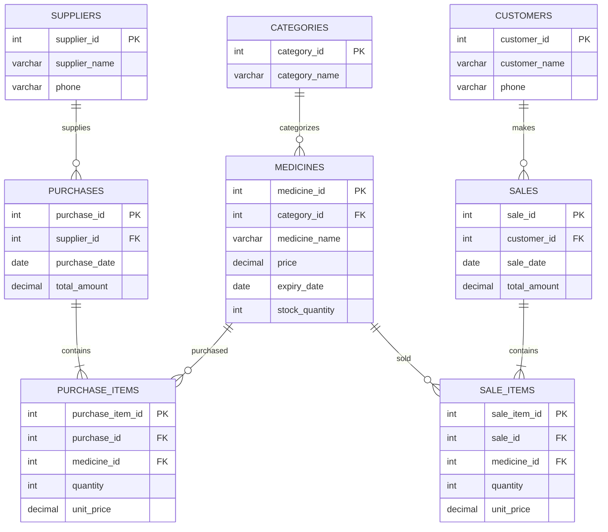
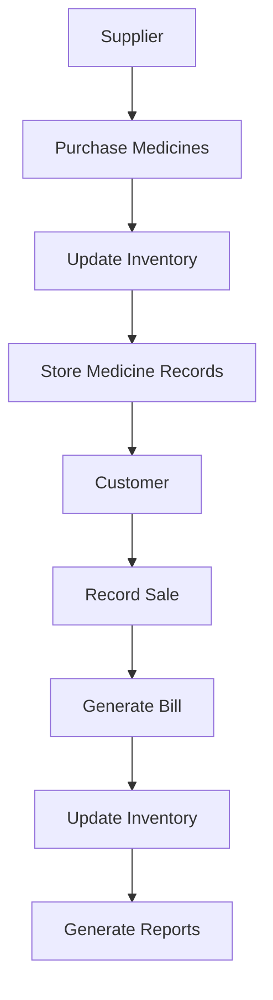

# 💊 Pharmacy Management System

<p align="center">

**A Database-Driven Pharmacy Management Solution**

Built with PHP, MySQL, HTML, CSS, and JavaScript

[Features](#-features) · [Database Design](#-database-design) · [Installation](#-installation-guide) · [Project Goals](#-project-goals)

</p>

---

## 📌 Project Overview

The **Pharmacy Management System** is a database-driven application designed to simplify and organize the daily operations of a pharmacy. It manages medicines, categories, suppliers, customers, purchases, sales, and inventory through a structured MySQL database.

Traditional pharmacy record-keeping can lead to inaccurate stock information, difficulty tracking expired medicines, and delays in finding records. This project aims to address these challenges by providing a centralized and organized database management solution.

### 🎯 Project Objectives

- Digitize pharmacy record management.
- Maintain accurate medicine and inventory records.
- Track purchases from suppliers and sales to customers.
- Simplify medicine searching and record retrieval.
- Generate basic sales, purchase, low-stock, and expiry reports.
- Demonstrate practical Database Management System (DBMS) concepts.

---

## ✨ Features

| Feature | Description |
|---|---|
| 💊 Medicine Management | Add, update, delete, and search medicines. |
| 🗂️ Category Management | Organize medicines by category. |
| 🚚 Supplier Management | Maintain supplier details and contact information. |
| 👥 Customer Management | Store customer information and purchase history. |
| 📥 Purchase Management | Record medicine purchases from suppliers. |
| 🧾 Sales Management | Record sales and generate bills. |
| 📦 Stock Management | Update inventory after purchases and sales. |
| ⚠️ Low-Stock Reports | Identify medicines with insufficient stock. |
| ⏰ Expiry Reports | Identify medicines approaching or past their expiry dates. |
| 📊 Basic Reports | Review sales and purchase records. |
| 🔍 Search Functionality | Find medicine and business records quickly. |

> **Note:** The features listed above describe the proposed project scope. Their implementation depends on the current application code.

---

## 🛠️ Technology Stack

| Technology | Purpose |
|---|---|
| HTML5 | Application structure |
| CSS3 | Styling and layout |
| JavaScript | Client-side interactions |
| PHP | Backend application logic |
| MySQL | Relational database |
| XAMPP | Local development environment |

---

## 🗄️ Database Design

The project uses a relational database designed to organize pharmacy operations and maintain relationships between related records.

### Database Tables

| Table | Primary Key | Purpose |
|---|---|---|
| `categories` | `category_id` | Stores medicine categories. |
| `medicines` | `medicine_id` | Stores medicine information, prices, expiry dates, and stock quantities. |
| `suppliers` | `supplier_id` | Stores supplier information. |
| `customers` | `customer_id` | Stores customer information. |
| `purchases` | `purchase_id` | Stores purchase transaction details. |
| `purchase_items` | `purchase_item_id` | Stores individual medicines and quantities for each purchase. |
| `sales` | `sale_id` | Stores sales transaction details. |
| `sale_items` | `sale_item_id` | Stores individual medicines and quantities for each sale. |

### 🔗 Entity Relationships

- **Categories → Medicines:** One-to-many.
- **Suppliers → Purchases:** One-to-many.
- **Customers → Sales:** One-to-many.
- **Purchases → Purchase Items:** One-to-many.
- **Sales → Sale Items:** One-to-many.
- **Medicines → Purchase Items:** One-to-many.
- **Medicines → Sale Items:** One-to-many.

The `purchase_items` and `sale_items` tables connect medicines with purchase and sales transactions, resolving the many-to-many relationships.

### Database Relationship Diagram



---

## 🔄 System Workflow



The system follows a simple workflow: medicines are purchased from suppliers, inventory is updated, sales are recorded, stock is adjusted, and reports are generated from transaction records.

---

## 🧠 DBMS Concepts Demonstrated

This project demonstrates the following database concepts:

- **Relational Database Design** — Organizing data into related tables.
- **Primary Keys** — Uniquely identifying database records.
- **Foreign Keys** — Maintaining relationships between tables.
- **Normalization** — Reducing unnecessary duplication and improving data integrity.
- **CRUD Operations** — Create, Read, Update, and Delete.
- **SQL Queries** — Insert, update, delete, and retrieve records.
- **JOIN Operations** — Combining data from related tables.
- **Aggregate Functions** — Calculating totals, quantities, and sales summaries.
- **ER Diagrams** — Representing database entities and relationships.
- **Referential Integrity** — Maintaining valid relationships between records.

---

## 🚀 Installation Guide

Follow these steps to run the project locally.

### Prerequisites

Install the following software:

- [XAMPP](https://www.apachefriends.org/)
- A modern web browser
- A code editor, such as [Visual Studio Code](https://code.visualstudio.com/)

### Step 1: Clone the Repository

Open your terminal and run:

```bash
git clone https://github.com/Mahdi-hasan-shuvo/DBMS-Project.git
```

Navigate to the project directory:

```bash
cd DBMS-Project
```

### Step 2: Move the Project to XAMPP

Copy the project folder into your XAMPP `htdocs` directory.

Example on Windows:

```text
C:\xampp\htdocs\DBMS-Project
```

### Step 3: Start XAMPP Services

Open the XAMPP Control Panel and start:

- Apache
- MySQL

### Step 4: Create the Database

1. Open [http://localhost/phpmyadmin](http://localhost/phpmyadmin).
2. Create a database named `pharmacy_management`.
3. Import the project's SQL database file if one is included in the repository.

If no SQL file exists yet, create the required tables using the proposed database design before running the application.

### Step 5: Configure the Database Connection

Update the application's database configuration with your local MySQL credentials.

Example configuration:

```php
<?php
$host = "localhost";
$username = "root";
$password = "";
$database = "pharmacy_management";

$conn = new mysqli(
    $host,
    $username,
    $password,
    $database
);

if ($conn->connect_error) {
    die("Database connection failed.");
}

$conn->set_charset("utf8mb4");
?>
```

Use the configuration file and variable names expected by your application. The example above assumes the default local XAMPP MySQL credentials.

### Step 6: Run the Application

Open your browser and visit:

[http://localhost/DBMS-Project/](http://localhost/DBMS-Project/)

The exact URL may vary depending on the project's folder structure and entry-point file.

---

## 📁 Suggested Project Structure

```text
DBMS-Project/
│
├── assets/
│   ├── css/
│   ├── js/
│   └── images/
│
├── config/
│   └── database.php
│
├── includes/
│   ├── header.php
│   └── footer.php
│
├── medicines/
├── categories/
├── suppliers/
├── customers/
├── purchases/
├── sales/
├── reports/
│
├── database/
│   └── pharmacy_management.sql
│
├── index.php
├── README.md
└── .gitignore
```

This is a suggested structure, not a claim about the repository's existing files.

---

## 📊 Expected Reports

The proposed system can provide the following reports:

1. **Medicine Inventory Report** — Current medicine quantities and prices.
2. **Sales Report** — Recorded sales and transaction totals.
3. **Purchase Report** — Medicines purchased from suppliers.
4. **Low-Stock Report** — Medicines requiring replenishment.
5. **Expiry Report** — Medicines approaching or past their expiry dates.

Report availability depends on the implemented SQL queries and application functionality.

---

## 🔐 Data Integrity and Security

Recommended practices for the project include:

- Use prepared statements for database queries.
- Validate user inputs before processing.
- Apply primary-key and foreign-key constraints.
- Use database transactions for purchases and sales.
- Prevent stock quantities from becoming negative.
- Calculate transaction totals consistently.
- Restrict access to sensitive database configuration files.
- Avoid storing production credentials in source control.

---

## 🎓 Project Goals

By completing this project, students can gain practical experience in:

- Designing a normalized relational database.
- Building and managing MySQL tables.
- Implementing relationships using primary and foreign keys.
- Performing CRUD operations with SQL.
- Retrieving related information using JOIN queries.
- Managing inventory-related transactions.
- Generating reports from structured data.

---

## 🔮 Future Improvements

Possible future enhancements include:

- User authentication and role-based access control.
- Barcode-based medicine searching.
- Batch-level inventory and expiry tracking.
- Automated low-stock notifications.
- Printable invoices.
- Advanced dashboards and analytics.
- Database backup and restore functionality.

These are potential extensions and are not necessarily included in the current version.

---

## 👨‍💻 Project Information

| Field | Details |
|---|---|
| Project Name | Pharmacy Management System |
| Project Type | Database Management System (DBMS) Project |
| Database | MySQL |
| Backend | PHP |
| Frontend | HTML, CSS, JavaScript |
| Local Server | XAMPP |
| Repository | [DBMS-Project](https://github.com/Mahdi-hasan-shuvo/DBMS-Project) |
| Author / Student | Mahdi Hasan Shuvo |
| Student ID | To be added |
| Course / Semester | To be added |

---

## 📸 Screenshots

Add screenshots of the actual application here to showcase its interface and functionality.

Suggested screenshots:

- Dashboard
- Medicine Management
- Supplier Management
- Purchase Management
- Sales and Billing
- Inventory Reports

Example Markdown:

```markdown

```

Create a `screenshots/` folder and add the corresponding images before using these links.

---

## 📄 License

This project is intended for educational and academic purposes. Add a `LICENSE` file if you want to distribute it under a specific open-source license.

---

<p align="center">

**Pharmacy Management System**

*Organizing pharmacy operations through relational database management.*

</p>
